# Redesign captures

`before/` is the agent-pairing branch (#8); `after/` is this redesign.
`home`, `more` and `status-sheet` are from the iOS simulator (empty test wallet).
`activity`, `swap-recap` and `agent` are rendered by `test/design_capture_test.dart`
with synthetic data:

    ZIPHER_DESIGN_CAPTURE=$PWD/docs/design/after flutter test test/design_capture_test.dart

| Screen | Before | After |
|---|---|---|
| Home | 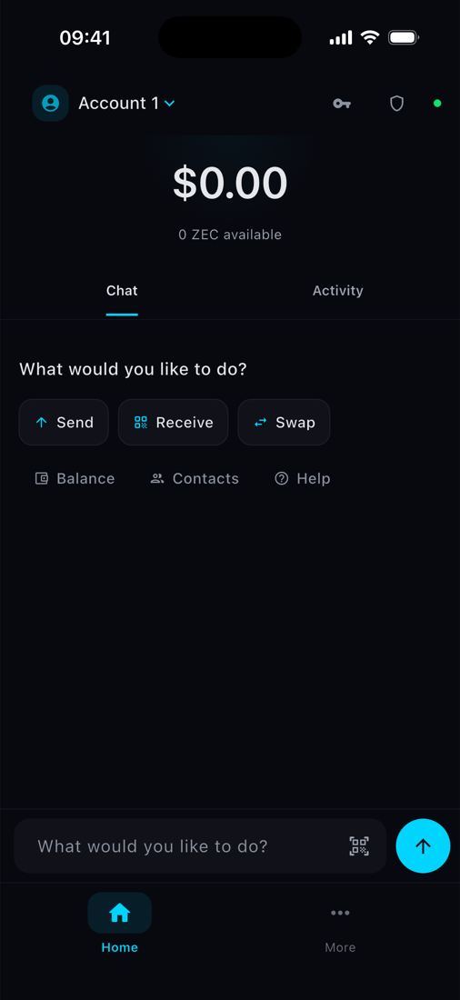 | 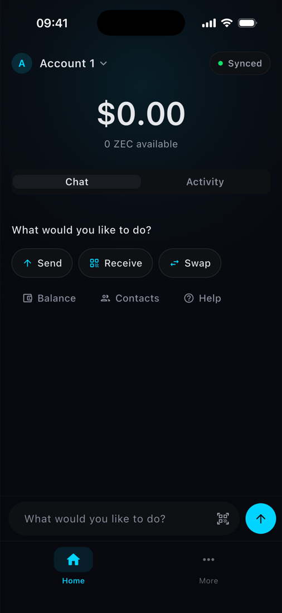 |
| Wallet status | — | 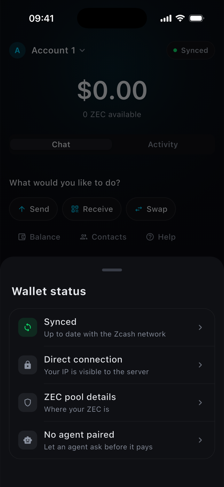 |
| Activity | 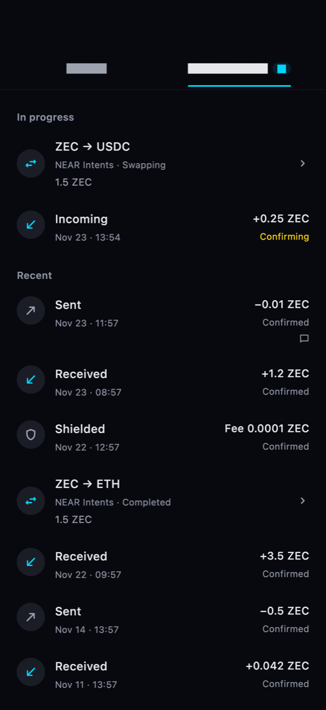 | 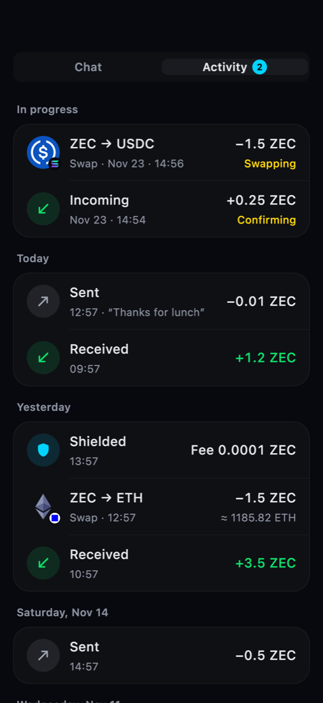 |
| Swap recap | 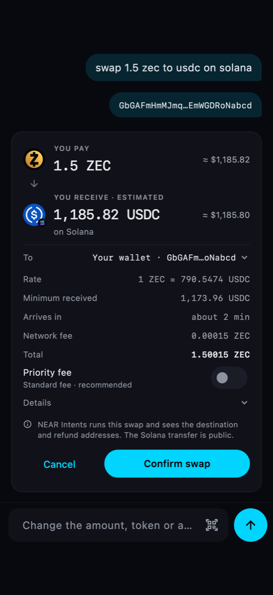 | 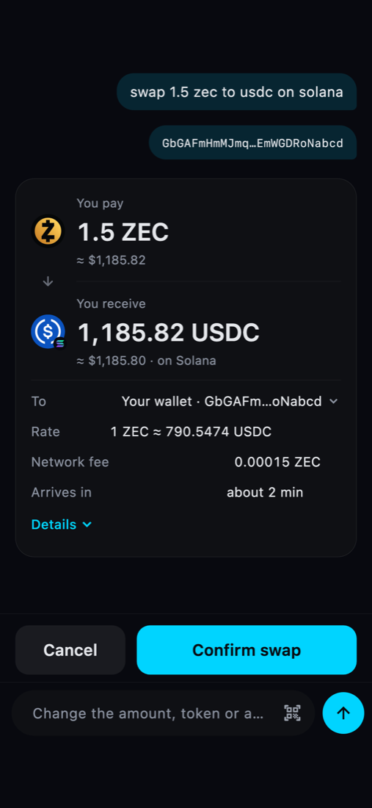 |
| More | 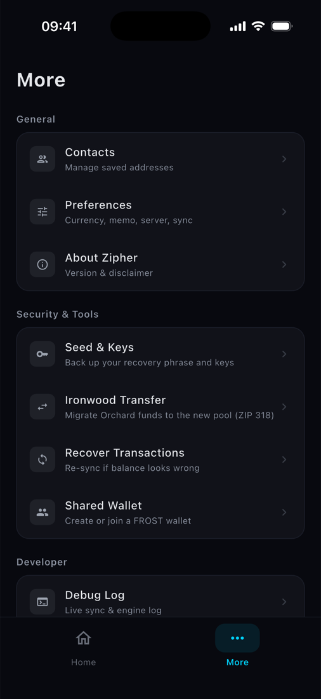 | 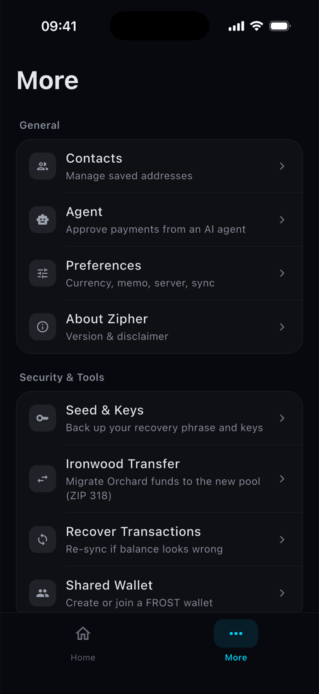 |
| Agent | 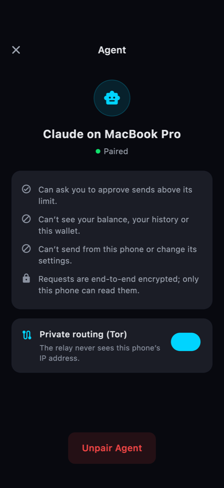 | 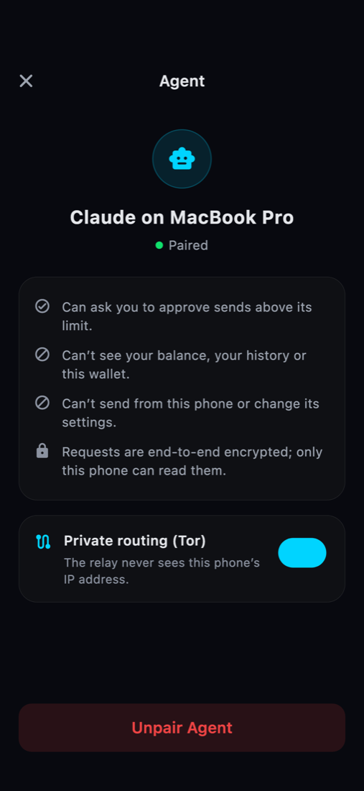 |
| Buttons (About) | — | 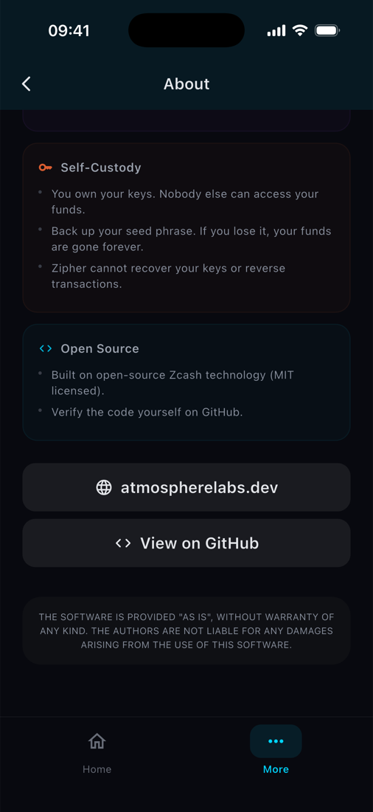 |
| Buttons (dialog) | — | 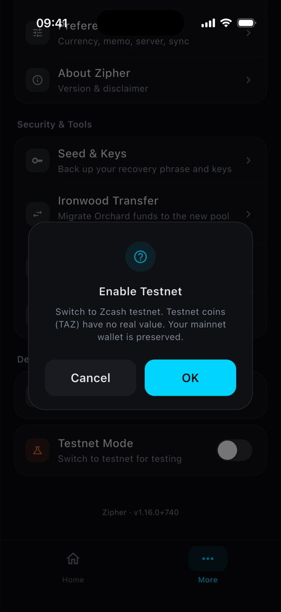 |
